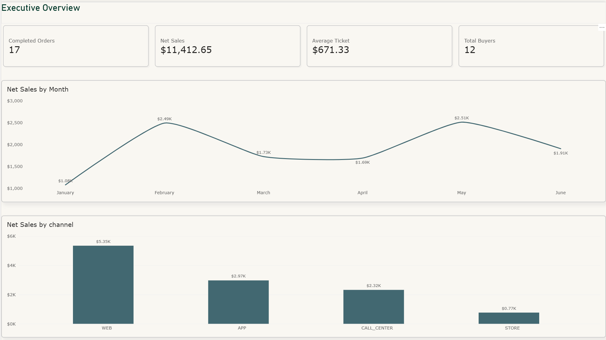
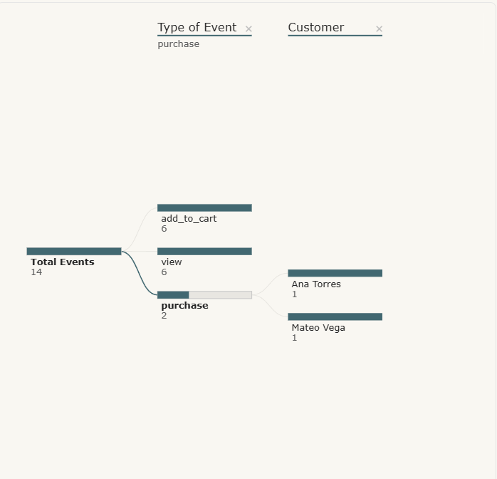

# Retail Sales & Digital Behavior Analytics — PySpark, Spark SQL & Power BI

> 🇬🇧 English | [🇪🇸 Español](#-español)

  

## 🇬🇧 English

### Business question
**How did sales perform in H1 2026 across countries, categories and channels, and how does digital behavior (view → add to cart) relate to completed purchases?**

### Why it matters
Sales reporting is only as good as the data behind it. The raw sources (customers, products, orders, digital events) arrive with duplicates, schema drift, orphan references and nested JSON. Without explicit cleaning rules, revenue is overstated and customer metrics are unreliable. This project builds a documented, tested pipeline that turns those sources into a trustworthy analytics layer for BI.

### Results at a glance
| KPI | Value |
|---|---|
| Net sales (H1 2026) | **$11,412.65** |
| Completed orders | **17** |
| Average ticket | **$671.33** |
| Buying customers | **12** |
| Top channel | **WEB — 46.9%** of net sales ($5,349.27) |
| Top country | **Ecuador — 47.0%** of net sales ($5,360.85) |
| Peak month | **May 2026 — $2,513.30** |
| Orders quarantined for data issues | **2** (of 21 unique orders) |




### Key findings
- **Revenue is concentrated.** WEB and Ecuador each account for ~47% of net sales; two motorcycle orders alone represent 32.1% ($3,668.00).
- **Mid-quarter peaks are driven by single orders.** February ($2,493.00) and May ($2,513.30) peak because one motorcycle order explains 74% and 73% of each month. Without them, both would be the weakest months of their quarter. Worth validating with a longer history before treating it as seasonality.
- **Digital intent converts.** 5 of 6 customers with a view → add-to-cart sequence later bought the product (83%). Only 2 of those 5 purchases have a `purchase` event, so event tracking under-reports conversions.

### Approach
1. **Ingestion & data quality** – schema, row count and null/duplicate profiling for each source.
2. **Cleaning rules** (problem → decision → rationale):

| Problem | Decision | Rationale |
|---|---|---|
| Duplicate customer, order (`O-1009`) and event (`E-010`) | Drop exact duplicates; one row per `event_id` | Avoids double-counting revenue and activity |
| Apr–Jun orders with numeric fields as strings | Explicit casts before union | Safe consolidation of both order files |
| Order with unknown customer and product (`O-1020`) | Quarantine in `orders_rejected` | Revenue cannot be attributed |
| Completed order with empty `items` (`O-1021`) | Quarantine | No revenue to recognize; likely a system bug |
| Cancelled / returned orders | Keep, net sales = 0 | Preserves status analysis without inflating revenue |
| Discount defined per order | Allocate to lines proportionally to line subtotal | Product/category net sales reconcile to order totals |
| Null `age` / `segment` (customer 105) | `segment` → `UNKNOWN`; `age` stays null | Not used in any metric; no fabricated data |
| Numeric campaign code, accents in names | Set to null / native normalization | Valid identifiers and consistent keys |

3. **Transformations** – order consolidation, `explode` of nested items, net sales, customer KPIs (orders, net sales, average ticket, first/last purchase, category breadth).
4. **Window functions** – previous order and days between purchases per customer; top-3 products per country with deterministic tie-break.
5. **Nested data** – flattening structs/arrays in digital events with native Spark functions.
6. **Spark SQL** – net sales by country/month/category, above-average customers, product ranking, channel pivot, abandoned-cart detection.
7. **BI layer** – curated tables exported to `output/` and visualized in Power BI.
8. **Built-in test** – line-level net sales must reconcile with order-level totals (assertion in the notebook).

### Tech stack
Python · PySpark 3.5.6 · Spark SQL · pandas · Power BI

### Repository structure
```
├── README.md
├── notebooks/
│   └── retail_sales_spark_analytics.ipynb
├── data/
│   └── README.md          # expected files and schemas (data not included)
├── output/                # curated CSVs for Power BI (generated)
├── images/                # dashboard screenshots
├── requirements.txt
└── .gitignore
```

### How to run
1. `pip install -r requirements.txt` (Java 11, 17 or 21 required for Spark).
2. Place the five JSON files in `data/` following `data/README.md`.
3. Open `notebooks/retail_sales_spark_analytics.ipynb` and run all cells. Curated tables are written to `output/`.

### Limitations & next steps
- Small sample (10–15 records per source): results illustrate the method, not statistical conclusions.
- Customer 105 has no `age`/`segment`; imputation was intentionally not applied.
- Next: partition curated tables by order month for larger histories, and add order-level campaign attribution.

---

## 🇪🇸 Español

### Pregunta de negocio
**¿Cómo se comportaron las ventas del primer semestre de 2026 por país, categoría y canal, y cómo se relaciona el comportamiento digital (vista → carrito) con las compras completadas?**

### Por qué importa
Un reporte de ventas es tan confiable como los datos que lo respaldan. Las fuentes (clientes, productos, órdenes y eventos digitales) llegan con duplicados, cambios de schema, referencias huérfanas y JSON anidado. Sin reglas de limpieza explícitas, los ingresos se sobrestiman y las métricas de cliente pierden confiabilidad. Este proyecto construye un pipeline documentado y validado que convierte esas fuentes en una capa analítica confiable para BI.

### Resultados clave
| KPI | Valor |
|---|---|
| Ventas netas (1S 2026) | **$11,412.65** |
| Órdenes completadas | **17** |
| Ticket promedio | **$671.33** |
| Clientes compradores | **12** |
| Canal principal | **WEB — 46.9%** de la venta neta ($5,349.27) |
| País principal | **Ecuador — 47.0%** de la venta neta ($5,360.85) |
| Mes pico | **Mayo 2026 — $2,513.30** |
| Órdenes en cuarentena por calidad de datos | **2** (de 21 órdenes únicas) |

### Hallazgos
- **Ingresos concentrados.** WEB y Ecuador aportan cada uno ~47% de la venta neta; solo dos órdenes de motocicletas representan el 32.1% ($3,668.00).
- **Los picos de mitad de trimestre dependen de órdenes individuales.** Febrero ($2,493.00) y mayo ($2,513.30) destacan porque una orden de motocicleta explica el 74% y el 73% de cada mes. Sin ellas, ambos serían los meses más bajos de su trimestre. Conviene validarlo con más historia antes de asumir estacionalidad.
- **La intención digital convierte.** 5 de 6 clientes con secuencia vista → carrito compraron luego el producto (83%). Solo 2 de esas 5 compras tienen evento `purchase`: el tracking subestima las conversiones.

### Enfoque
1. **Ingesta y calidad de datos** – schema, conteos y perfilado de nulos/duplicados por fuente.
2. **Reglas de limpieza** (problema → decisión → justificación):

| Problema | Decisión | Justificación |
|---|---|---|
| Cliente, orden (`O-1009`) y evento (`E-010`) duplicados | Eliminar duplicados exactos; una fila por `event_id` | Evita duplicar ingresos y actividad |
| Órdenes abr–jun con campos numéricos como string | Conversión explícita antes del union | Consolidación segura de ambos archivos |
| Orden con cliente y producto inexistentes (`O-1020`) | Cuarentena en `orders_rejected` | No se puede atribuir el ingreso |
| Orden completada con `items` vacío (`O-1021`) | Cuarentena | Sin ingreso que reconocer; probable error de sistema |
| Órdenes canceladas / devueltas | Conservar con venta neta = 0 | Mantiene el análisis por estado sin inflar ingresos |
| Descuento definido por orden | Prorrateo entre líneas según su subtotal | La venta neta por producto/categoría cuadra con la orden |
| `age` / `segment` nulos (cliente 105) | `segment` → `UNKNOWN`; `age` sin imputar | No se usan en métricas; no se fabrican datos |
| Campaña numérica, tildes en nombres | Nulo / normalización nativa | Identificadores válidos y llaves consistentes |

3. **Transformaciones** – consolidación de órdenes, `explode` de ítems, ventas netas, KPIs por cliente (órdenes, ventas netas, ticket promedio, primera/última compra, variedad de categorías).
4. **Window functions** – orden anterior y días entre compras por cliente; top 3 productos por país con desempate determinístico.
5. **Datos anidados** – aplanado de structs/arrays en eventos digitales con funciones nativas de Spark.
6. **Spark SQL** – ventas por país/mes/categoría, clientes sobre el promedio, ranking de productos, pivote por canal, detección de carritos abandonados.
7. **Capa BI** – tablas curadas exportadas a `output/` y visualizadas en Power BI.
8. **Prueba integrada** – la venta neta por línea debe cuadrar con el total por orden (aserción en el notebook).

### Stack tecnológico
Python · PySpark 3.5.6 · Spark SQL · pandas · Power BI

### Estructura del repositorio
Ver sección en inglés.

### Cómo ejecutar
1. `pip install -r requirements.txt` (Spark requiere Java 11, 17 o 21).
2. Coloca los cinco archivos JSON en `data/` según `data/README.md`.
3. Abre `notebooks/retail_sales_spark_analytics.ipynb` y ejecuta todas las celdas. Las tablas curadas se escriben en `output/`.

### Limitaciones y próximos pasos
- Muestra pequeña (10–15 registros por fuente): los resultados ilustran el método, no son conclusiones estadísticas.
- El cliente 105 no tiene `age`/`segment`; se decidió no imputar.
- Siguiente: particionar las tablas curadas por mes de orden para históricos mayores y agregar atribución de campaña a nivel de orden.
